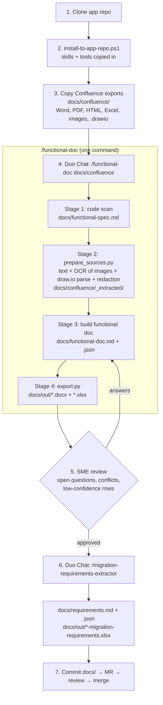

# Workflow: App Functional Document → Migration Requirements

**TL;DR:** Clone the app repo, install the toolkit, drop in the Confluence exports, then run `/functional-doc docs/confluence` in GitLab Duo Chat (VS Code). You get the functional document in Word + Excel. After SME review, `/migration-requirements-extractor` gives the requirements in Excel.

**Who it's for:** migration engineers and BAs documenting an app before its wave.

## Steps

| # | Step | Command / action | Output |
|---|---|---|---|
| 1 | Clone the app repo | `git clone <app-repo-url> C:\work\<app>` | Local repo |
| 2 | Install the toolkit (from this AI repo) | `.\tools\install-to-app-repo.ps1 -AppRepo C:\work\<app> -InstallPython` | `.agents/skills/`, `tools/doc-prep/`, `tools/office-export/` in the app repo |
| 3 | Add the Confluence documents | Export the pages (**⋯ → Export → Word** or HTML), draw.io diagrams (**Export → XML** → `.drawio`), and images into `docs/confluence/`. Optional: `<image>.image.md` describing key diagrams | Source folder |
| 4 | Build the functional doc | VS Code → Duo Chat → new conversation → `/functional-doc docs/confluence APP NAME: <name>` | `docs/functional-spec.md`, `docs/functional-doc.md/.json`, `docs/out/<app>-functional-doc.docx/.xlsx` |
| 5 | SME review | Send the Word/Excel to the app owner. Feed answers back: `The SME answered: OQ-001: ..., CF-001: .... Update both files, keep IDs stable, re-export.` | Reviewed doc |
| 6 | Migration requirements | New conversation → `/migration-requirements-extractor Cloud: <..>. Pattern: <..>. Compliance: <..>. Downtime: <..>.` | `docs/requirements.md/.json`, `docs/out/<app>-migration-requirements.xlsx` |
| 7 | Version it | Commit `docs/` on a branch, open an MR, review, merge | Approved artefacts in the app repo |

## What each piece does

| Piece | Type | Role |
|---|---|---|
| `/functional-doc` | Duo skill | Orchestrates stages 1–4 from one command |
| `/app-functionality-extractor` | Duo skill | Stage 1: reads the code, writes the code spec with file/line evidence |
| `tools/doc-prep/prepare_sources.py` | Python | Stage 2: Confluence exports → text; OCR on images (Windows built-in OCR, no admin); exact draw.io parsing; secret redaction |
| `/app-functional-doc-builder` | Duo skill | Stage 3: merges code + documents into the functional doc; cites every item, flags conflicts, raises open questions |
| `tools/office-export/export.py` | Python | Stage 4: validates the JSON (IDs, references, secrets) and writes Word + Excel |
| `/migration-requirements-extractor` | Duo skill | Step 6: reviewed functional doc → traceable migration requirements |

## Quality rules built in
- Every item cites its source (file and line, or document and section) and has a High/Medium/Low confidence.
- Code vs. document disagreements go to **Conflicts**. Nothing is silently chosen.
- Gaps go to **Open Questions**. Nothing is invented.
- Flows read from images by OCR are Low confidence and need SME confirmation; `.drawio` connections are exact.
- Secrets are redacted before Duo sees the documents, and `export.py` blocks output that still contains one.
- Requirements are built only from the SME-reviewed functional doc.

## When it goes wrong
| Symptom | Fix |
|---|---|
| `/skills` doesn't list `functional-doc` | Start a new conversation; GitLab for VS Code must be 6.71.4+; re-run step 2 |
| "toolkit isn't installed" | Re-run step 2 |
| `OCR engine: none` | `python -m pip install -r tools/doc-prep/requirements.txt` (Windows 10/11) |
| Diagram flow wrong | Export it as `.drawio`, or add `<image>.image.md`, then re-run step 4 |
| Run stops (large app) | New conversation, same command. Finished stages are reused |
| Duo can't run `python` | Run the command it shows you in a terminal, then tell it to continue |
| `export.py` errors | Duo fixes them automatically (2 tries); otherwise paste the errors into chat |

## Escalate to
- Skills, tools, prompts: `<AI lead name / channel>`
- App facts: the app owner named in the functional doc

Details: [README](README.md) · [Confluence playbook](confluence/how-to-build-app-functional-doc.md) · [doc-prep](tools/doc-prep/README.md) · [office-export](tools/office-export/README.md)
